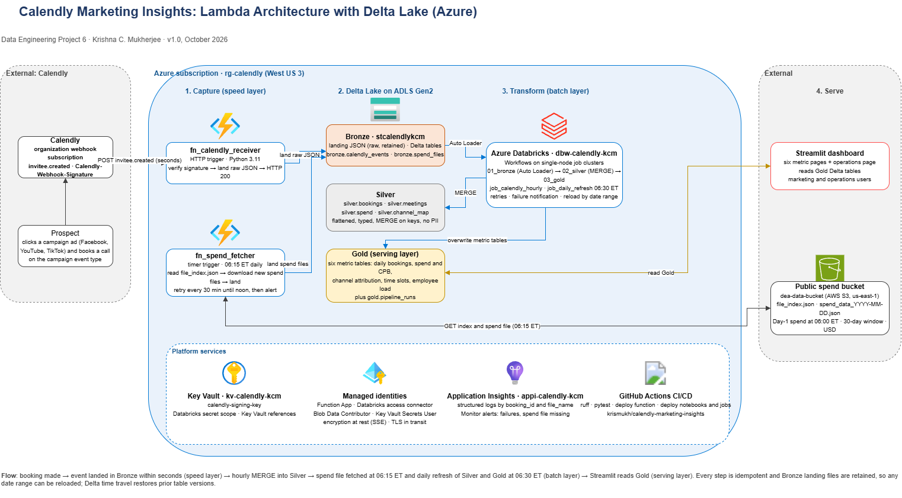

# Calendly Marketing Insights

Data Engineering Project 6. A pipeline that joins Calendly booking events, received through
webhooks, with daily marketing spend data, stores the data in Delta Lake on Azure Data Lake
Storage Gen2 in Bronze, Silver, and Gold layers, and presents six marketing and
calendar-optimization metrics in a Streamlit dashboard.

Implemented on Microsoft Azure following the Databricks reference design in the brief.
The architecture proposal and diagram are in `docs/`.

## Status

| Phase | Scope | Status |
|---|---|---|
| 0. Preparation | Repository, fixtures, decision log, spend source check | Complete |
| 1. Environment | `infra/create_environment.sh`, `infra/configure_databricks.sh` | Complete |
| 2. Capture | `fn_calendly_receiver`, `fn_spend_fetcher`, unit tests | Awaiting SME approval |
| 3. Delta Lake layers | `01_bronze`, `02_silver`, `03_gold` notebooks | Awaiting SME approval |
| 4. Scheduling, CI/CD, observability | Databricks jobs, GitHub Actions deployment, alerts | Awaiting SME approval |
| 5. Dashboard | Streamlit application | Awaiting SME approval |
| 6. Subscription and validation | Webhook subscription, live bookings, validation report | Awaiting SME approval |

## Architecture



Lambda architecture on Azure (proposal Section 4):

- **Speed layer.** An HTTP-triggered Azure Function (`fn_calendly_receiver`) verifies each
  Calendly `invitee.created` webhook and lands the raw event in the Bronze container within
  seconds. An hourly Azure Databricks job merges new events into the Bronze and Silver Delta
  tables.
- **Batch layer.** A timer-triggered function (`fn_spend_fetcher`) lands the previous day's
  spend file from the public bucket after 06:00 AM Eastern. A daily Databricks job at
  06:30 AM Eastern rebuilds Silver and Gold over the full history.
- **Serving layer.** Gold Delta tables, read by the Streamlit dashboard.

| Component | Azure resource |
|---|---|
| Webhook receiver, spend fetcher | Function App `func-calendly-kcm` (Linux Consumption, Python 3.11) |
| Delta Lake | ADLS Gen2 `stcalendlykcm`, containers `bronze`, `silver`, `gold` |
| Processing and scheduling | Azure Databricks `dbw-calendly-kcm` (Workflows, single-node job clusters) |
| Secrets | Key Vault `kv-calendly-kcm`; Key Vault-backed secret scope `calendly` |
| Monitoring | Application Insights `appi-calendly-kcm`; Databricks job notifications; Azure Monitor alerts |
| CI/CD | GitHub Actions (`.github/workflows/ci.yml`) |

## Repository layout

| Path | Content |
|---|---|
| `docs/` | Architecture proposal (Word), draw.io diagram, decision log, phase runbooks |
| `infra/` | `create_environment.sh`, `verify_environment.sh`, `configure_databricks.sh` |
| `src/functions/` | Azure Functions project (Phase 2) |
| `src/calendly_pipeline/` | Shared modules: signature verification, landing writes, spend client (Phase 2) |
| `notebooks/` | Databricks notebooks in source form (Phase 3) |
| `jobs/` | Databricks job definitions (Phase 4) |
| `dashboards/` | Streamlit application (Phase 5) |
| `tests/` | pytest unit tests; `tests/fixtures/` holds the sample event and spend records from the brief |
| `scripts/` | `check_spend_source.py`; later `send_test_event.py`, `reload_range.py` |

## Local setup (workstation)

```
python -m venv .venv
.venv\Scripts\activate
pip install -r requirements-dev.txt
copy .env.example .env
ruff check . && ruff format --check . && pytest -q
python scripts\check_spend_source.py
```

`.env` is ignored by git. The spend bucket is public, so the check needs no credentials.

## Azure environment

See `docs/phase1_environment.md` for the resources, settings, run instructions, and
verification checklist.

## Why this stack

To be completed with the final submission (brief, Step 6): the reason for each technology
chosen, with reference to the proposal.
